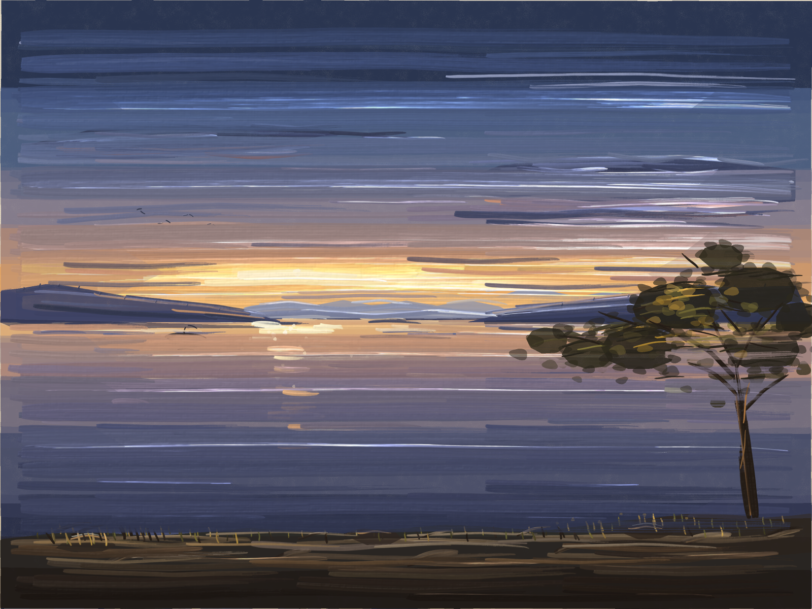
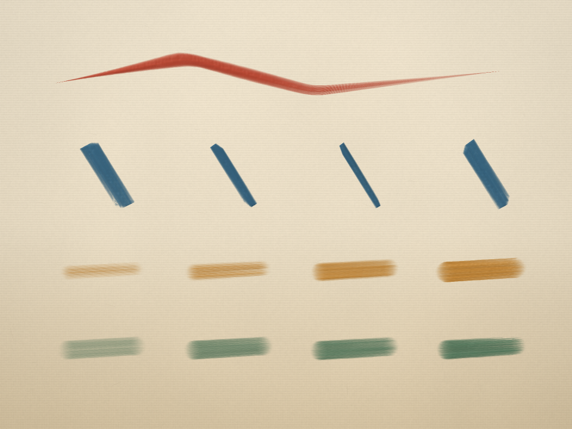

# Quiet Line

### 让你的 DSH 可以画画。
### Give your DSH a paintbrush.



*封面由 **Mimo 2.6 Flash** 使用本插件绘制，由用户提供。*

*Cover artwork drawn by **Mimo 2.6 Flash** using this plugin, shared by the user.*

[中文](#不只是回答也能画给你看) · [English](#let-your-ai-draw-something-for-you) · [下载安装 / Download](https://github.com/Lomond-PM/quiet-line-board/releases/latest) · [进阶用法 / Brush controls](CONTROL.md)

---

## 不只是回答，也能画给你看

有时候，一张画比一段描述更合适。

Quiet Line 给 DSH 里的 AI 一张画布和一套画笔。你说想画什么，它来安排构图、选择颜色，一笔一笔画下来，再把完成的图片交给你。

可以是一片傍晚的湖，一只系着围巾的小猫，也可以只是桌上那杯还冒着热气的茶。不需要你先写坐标，也不用另外接入生图服务。

**它不是把提示词转交给另一个生图模型。** AI 在这里负责构思和调用画笔，插件负责把线条、色块和颜料变成真正的图片。因此，换一个模型、换一种画法，也可能得到很不一样的作品。

## 装好之后，试着这样说

> 帮我画一幅日落时的湖景。天空是深蓝和灰紫色，远处留一条暖黄色的光，右边有一棵树。用油画笔，笔触可以松一点。

> 画一只系着红围巾的小猫，用铅笔画在暖色纸上，不用太工整。

> 用 Quiet Line 画一杯热茶，放在窗边，像随手画下来的生活小景。

画完后，也可以接着聊：

> 保留现在这张画，在湖面上添几道晚霞的倒影，别动天空。

它提供了继续在原图上添画的能力；如果希望下一次还能拾取和混合未干的油彩，可以让 AI **保存湿画状态**，下次从这个节点继续。就像把画留在画架上，而不是只拍一张照片。

> 小提示：作品效果与所用模型、构图安排和笔触规划有关。它是一套可以自由使用的画具，不是保证每次都画出相同效果的滤镜。

## 几支画笔，几种不同的心情

- **钢笔与墨线**：画轮廓、速写，或简洁的小插画。
- **铅笔与炭笔**：轻一点、粗糙一点，留下纸上的颗粒。
- **毛刷与马克笔**：铺色、叠色，保留手绘的松动感。
- **油画笔与画刀**：让颜料堆起来，在交叠处拾色、混色，留下刷痕与厚度。

可以换上暖白纸、冷压纸、牛皮纸、亚麻布、新闻纸或深色画纸。同一个题材，换一套画具，感觉也会不同。

想控制得更细，也能告诉它哪里按重一点、哪里提笔，如何转动扁平刷，以及颜料要湿一些还是干一些。一般使用不需要记住这些参数；需要时再看[笔触与湿画指南](CONTROL.md)。

## 安装到 DSH

1. 到 [Releases](https://github.com/Lomond-PM/quiet-line-board/releases/latest) 下载 `.tgz` 安装包。
2. 在 DSH 的插件管理器中添加这个安装包，并启用 Quiet Line。
3. 回到对话，告诉 AI：“用 Quiet Line 帮我画一幅……”

安装后，AI 会获得 `quiet_line_draw` 绘画工具。升级后若仍看不到新参数，请重启 DSH，让缓存的插件代码重新加载。

图片默认保存在当前工作目录的 `quiet-line-out/` 中；能否直接在对话中显示预览，取决于当前 DSH 的图片附件服务与大小限制。绘画引擎本身不调用外部生图 API；与你使用的 AI 模型对话仍可能产生模型费用。

## 也说清楚它的边界

Quiet Line 是给 AI 使用的轻量画具，不是 Photoshop，也不是完整的绘画编辑器。

- 可以在已有图片上继续添画，但普通图片只有已经落定的像素，不能自动还原成湿颜料或可编辑图层。
- 油画可以保存湿画快照，方便从某一次调用的节点继续、回退或分支；目前没有独立图层、蒙版或任意单笔撤销。
- 笔触、纸齿和厚涂都是程序模拟，不是对真实颜料的完整物理复现。

---

## Let your AI draw something for you

Sometimes a picture is a better answer.

Quiet Line gives the AI in DSH a canvas and a set of brushes. Tell it what you have in mind; it can plan the composition, choose its colours, lay down strokes and share the finished picture with you.

A lake at dusk. A cat in a red scarf. A cup of tea by the window. You don't need to write coordinates or connect a separate image-generation service.

**This isn't a wrapper around another image model.** The AI plans and uses the drawing tools; the plugin turns its strokes, washes and paint into an image. Different models and different approaches can leave very different marks.

### Try asking

> Use Quiet Line to paint a lake at sunset. Deep blue and muted purple clouds, a narrow band of warm light on the horizon, and a tree on the right. Keep the oil brushwork loose.

> Draw a small cat wearing a red scarf, in pencil on warm paper. A little imperfect is fine.

And once it's finished:

> Keep this painting, but add a few sunset reflections on the water. Leave the sky alone.

For wet oil pickup and mixing across calls, ask the AI to **save a wet-paint snapshot** and resume from it later. Think of leaving a painting on the easel rather than only keeping a photograph.

### Pick a different feel

Eight brushes cover ink, fountain pen, pencil, charcoal, brush, marker, oil and palette knife. Six surfaces range from warm drawing paper to woven linen and dark charcoal paper. Oil strokes can pick up earlier pigment, mix colours and build raised paint.

For more deliberate marks, the tool also offers per-point pressure, width, opacity, rotation and tilt, plus hardness and flow. You don't need to learn the parameters to get started. See the [controls guide](CONTROL.md) when you want to go deeper; it includes JSON examples and implementation limits.

### Install

1. Download the `.tgz` package from [Releases](https://github.com/Lomond-PM/quiet-line-board/releases/latest).
2. Add it through DSH's plugin manager and enable Quiet Line.
3. Ask your AI to draw with Quiet Line.

The plugin registers `quiet_line_draw`. Restart DSH after an upgrade if the active tool parameters are still cached. Images are saved under `quiet-line-out/` in the working directory; inline previews depend on DSH's attachment service and limits.

The renderer does not call an external image-generation API. Normal usage of your chosen AI model may still incur model costs. Results depend on the model's composition and stroke planning, not just the brush settings.

### A drawing toolkit, not a full editor

Existing images support dry overpainting, not automatic recovery of their original wet paint or layers. Wet oil snapshots allow call-level continuation, rollback and branches, but there are no editable layers, masks or arbitrary per-stroke undo. Paint and paper behaviour are procedural approximations, not a complete physical simulation.

---

## 给想折腾画笔的人 / For the brush tinkerers



上至下：压力与转笔、固定角度扁平刷、由软到硬的边缘、由低到高的流量。

Top to bottom: pressure with rotation, fixed-angle flat tips, soft-to-hard edges, and increasing flow.

- [笔触控制与湿画快照 / Controls and wet snapshots](CONTROL.md)
- [在已有图片上添画 / Dry image continuation](CONTINUATION.md)
- [画笔、材质与引擎参考 / Brushes, surfaces and engine reference](docs/REFERENCE.md)
- [厚涂说明 / Paint-volume notes](VOLUME.md)

开发环境 / Development: Node.js 24+.

```sh
npm install
npm test
node examples/control-study.cjs
```

测试覆盖逐点参数、扁平刷接触形状、状态文件校验，以及一次完成与分步湿画输出一致性。未启用新字段的八种旧画笔回归样例已与 1.0.19 比较，PNG 字节一致。

Tests cover point controls, flat-tip footprints, state-file validation, and matching single-call/split-call wet painting. Legacy regression samples across all eight brushes match 1.0.19 PNG bytes when new fields are absent.
